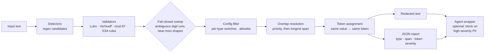

# pii-sanitizer-agent

A **fail-closed** PII redaction library, CLI, and prompt-sanitizing agent
wrapper in pure Python (standard library only — no dependencies, no network,
no API keys). It detects and redacts emails, phone numbers, US SSNs, Indian
Aadhaar numbers, passports, payment card numbers, IBANs, and API
keys/secrets, and produces a structured JSON redaction report alongside the
cleaned text.

## Problem statement

Text leaks identifiers constantly: support tickets pasted into tickets,
resumes and cover letters sent to third parties, logs shipped to vendors,
and — most sharply today — prompts sent to hosted LLM APIs. Most quick
regex scripts fail **open**: anything their patterns don't recognise sails
through untouched, so the one unusual format in a document is exactly the
one that leaks. A missed detection (false negative) can mean a breached
card number or government ID; an over-eager detection (false positive)
costs one awkward token in a document. Those costs are wildly asymmetric,
and this tool is built around that asymmetry.

## Fail-closed design

**When detection is uncertain, the sanitizer redacts rather than passes
through.** False positives are acceptable; false negatives are the failure
mode. Concretely:

| Situation | Strict detector result | Fail-closed behaviour (default) |
|---|---|---|
| 13–19 digit grouped number, **Luhn fails** | not a card | redacted as `[REDACTED_NUMBER_n]` — a typo'd or partially masked card is still a card |
| 4-4-4 grouped number, **Verhoeff fails** | not an Aadhaar | redacted as `[REDACTED_NUMBER_n]` |
| Dashed `3-2-4` number failing SSA structural rules | not an SSN | redacted as `[REDACTED_NUMBER_n]` — that shape is a strong signal |
| IBAN-shaped string failing mod-97 | not an IBAN | redacted as `[REDACTED_NUMBER_n]` |
| Any bare/separated digit run totalling **11–19 digits** | unclassified | redacted as `[REDACTED_NUMBER_n]` |
| Digit runs of ≤10 digits (order numbers, dates) | unclassified | left alone — below identifier size |

`fail_closed=False` (CLI: `--no-fail-closed`) turns all of this off: only
checksum/structure-valid findings from the strict detectors are redacted.
That mode exists for pipelines where false positives are genuinely costly;
the default is fail-closed because for PII the costs run the other way.

Supporting mechanisms:

- **Consistent replacement tokens** — the same raw value always maps to the
  same token within a document (`[EMAIL_1]`), numbered in document order
  per type, so coreference survives redaction. The report keeps a
  token → occurrence-count mapping. Raw values are **never** stored in the
  report, so the report itself is safe to log.
- **Allowlist** — exact values that must never be redacted (public contact
  addresses, published test card numbers). A candidate fully contained in
  an allowlisted occurrence is also suppressed, so fragments of an
  allowlisted value don't re-match looser detectors.
- **Per-type enable/disable** — `SanitizerConfig(disabled_types=...)`,
  `enabled_types=...`, CLI `--disable TYPE`.
- **Overlap resolution** — candidates are resolved by priority class
  (secrets > email > IBAN > card > SSN > Aadhaar > passport > phone >
  ambiguous), then longer span. A loser is dropped entirely, never
  partially redacted.

## Pipeline



## Quickstart

```bash
# library use (no install needed beyond the package itself)
pip install -e .

python -m pii_sanitizer sanitize examples/sample.txt
python -m pii_sanitizer sanitize examples/sample.txt --report report.json
cat notes.txt | python -m pii_sanitizer sanitize - --report   # report -> stderr
python -m pii_sanitizer sanitize notes.txt --format json     # combined payload
python -m pii_sanitizer sanitize notes.txt --no-fail-closed --disable PHONE
```

```python
from pii_sanitizer import PromptSanitizerAgent, Sanitizer, sanitize_text

result = sanitize_text("mail a@example.com, card 4242 4242 4242 4242")
result.text                    # 'mail [EMAIL_1], card [CARD_1]'
result.report.to_dict()        # structured report (no raw values)

agent = PromptSanitizerAgent(block_on_high_severity=True)
agent.process("summarise this thread")        # -> AgentResult(sanitized, report)
output, report = agent.run(prompt, my_llm_fn) # callable only sees clean text
```

## Captured example (real run)

Command: `python -m pii_sanitizer sanitize examples/sample.txt`
(input: [`examples/sample.txt`](examples/sample.txt), all values synthetic)

```text
Customer note (all values below are synthetic test data):

Name: Test User
Contact email: [EMAIL_1], backup: [EMAIL_2]
Phone (US): [PHONE_1]
Phone (India): [PHONE_2]
SSN on file: [SSN_1]
Aadhaar on file: [AADHAAR_1]
Passport: [PASSPORT_1] (US format sample)
Card charged: [CARD_1]
Bank IBAN: [IBAN_1]
Deploy config snippet: api_key = "[SECRET_1]"
Support reference number (not a real identifier): [REDACTED_NUMBER_1]
Please follow up with [EMAIL_1] about order 12345.
```

Note the deliberate behaviour in that output: the 14-digit "support
reference number" is **not** a real identifier, and it is redacted anyway —
that is fail-closed working as designed — while the 5-digit order number is
left alone. Report excerpt (`--report`):

```json
{
  "version": 1,
  "fail_closed": true,
  "total_findings": 12,
  "counts_by_type": {
    "EMAIL": 3, "PHONE": 2, "SSN": 1, "AADHAAR": 1, "PASSPORT": 1,
    "CARD": 1, "IBAN": 1, "SECRET": 1, "AMBIGUOUS_NUMBER": 1
  },
  "has_high_severity": true,
  "findings": [
    {"type": "EMAIL", "start": 90, "end": 111, "token": "[EMAIL_1]",
     "severity": "medium", "detector": "email"}
  ],
  "mapping": {"[EMAIL_1]": 2, "[EMAIL_2]": 1, "[PHONE_1]": 1, "[SSN_1]": 1}
}
```

## Detector table

| Type | Method | Validation | Precision / recall trade-off |
|---|---|---|---|
| EMAIL | regex | RFC-lite shape | High precision; misses deliberately obfuscated addresses (see Limitations) |
| PHONE | regexes for US, international (E.164-ish), Indian mobile | shape only — no checksum exists | Tuned for recall; short local numbers (7-digit) deliberately not targeted |
| SSN | regex `ddd-dd-dddd` | SSA structural rules (area/group/serial) | Invalid structures fall to the fail-closed sweep, not the SSN type |
| AADHAAR | regex (grouped, dashed, bare) | **Verhoeff checksum** + leading digit 2–9 | Checksum gives near-perfect precision on the typed finding; near misses still redacted as ambiguous |
| PASSPORT | context pattern (`passport number: X`) + US (letter+8) / India (letter+7) shapes | shape only | Shape-only matching is the weakest precision here; context pattern requires a digit in the value |
| CARD | regex 13–19 digits, grouped or bare | **Luhn checksum** | Luhn-valid ⇒ typed CARD; Luhn-invalid card shapes ⇒ fail-closed ambiguous |
| IBAN | regex per ISO 13616 shape | **mod-97** + country length for known countries | Checksum-validated, high precision |
| SECRET | known prefixes (`sk-`, `AKIA…`, `ghp_`, `github_pat_`, `xox…`), `Bearer` tokens, private-key headers, `key = value` assignments | length floor on values (≥8) | Assignment detection redacts the **value only**, keeping config readable; short values are deliberately ignored |
| AMBIGUOUS_NUMBER | fail-closed sweep | none — that is the point | Pure recall play: identifier-sized digit runs and near-miss shapes; expect false positives on long reference numbers |

## Agent wrapper

`PromptSanitizerAgent` wraps any "send this prompt to a model" flow without
owning the transport: `process()` returns the sanitized prompt plus the
report; `run(prompt, callable)` invokes the callable with the clean text
only. With `block_on_high_severity=True`, prompts containing SSN, Aadhaar,
card, IBAN, passport, secret, or ambiguous-number findings raise
`BlockedPromptError` (carrying the value-free report) and the callable is
never invoked — for material that should not leave the machine even in
redacted form.

## Limitations (honest)

Regex-based PII detection has known, structural limits. These are pinned
by tests in `tests/test_adversarial.py` so any future improvement is a
deliberate change:

- **Obfuscated emails are not detected**: `name [at] example dot com` and
  `name at example dot com` pass through. Deliberate obfuscation defeats
  shape matching by design.
- **Spelled-out or oddly separated digits are not detected**:
  `123 45 6789` (space-grouped SSN) and `one two three…` are missed;
  dot-separated card numbers (`4242.4242.4242.4242`) are not typed as cards.
- **No semantic understanding**: a Luhn-valid order number will be typed
  as a card; a 14-digit reference number will be redacted as ambiguous.
  That is the fail-closed bargain, and the allowlist is the escape hatch.
- **Passports are shape-only** — no checksum exists to validate against,
  so letter+digit codes of the right shape from other domains ( SKUs,
  asset tags) can be swept up, especially near the word "passport".
- **Secrets**: novel token formats without known prefixes and without a
  recognisable `key =` assignment shape will be missed. Environment-variable
  references (`api_key = os.environ[...]`) may be partially redacted —
  treat that as fail-closed noise.
- **Private keys**: only the `-----BEGIN … PRIVATE KEY-----` header line is
  tokenised, not the key body lines that follow it.
- Detection is per-document and stateless: nothing is learned across calls,
  and token numbering restarts per document.

## Tests

```bash
pip install pytest
python -m pytest        # 228 tests
```

The suite is the showcase: every detector has positive **and** negative
cases; validators are tested directly, including exhaustive Verhoeff
properties (every single-digit mutation and adjacent transposition of the
valid fixture must fail); fail-closed vs strict behaviour is contrasted for
every near-miss class; plus overlap resolution, allowlist semantics,
unicode, empty and ~216k-character inputs, secrets inside code snippets and
JSON, the agent wrapper's blocking contract, and full CLI coverage.

## Layout

```text
src/pii_sanitizer/
    __init__.py     public API
    __main__.py     python -m pii_sanitizer
    models.py       Finding / Report / SanitizerConfig
    validators.py   Luhn, Verhoeff, SSN rules, IBAN mod-97
    detectors.py    regex detectors + fail-closed sweep + overlap resolution
    sanitizer.py    orchestration: config, allowlist, token assignment
    agent.py        PromptSanitizerAgent + BlockedPromptError
    cli.py          argparse CLI
tests/              pytest suite (8 files, 228 tests)
examples/sample.txt synthetic-PII demo input
web/index.html      static before/after demo page
```

## License

MIT — see [LICENSE](LICENSE).
